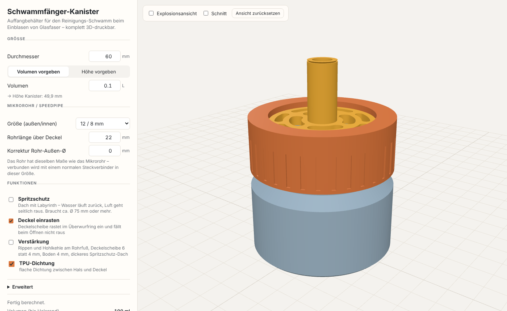

# Speedpipe-Kanister – Schwammfänger-Konfigurator

**👉 Direkt öffnen: https://raketenbomber.github.io/Speedpipe-kanister/**

Beim Einblasen von Glasfaser wird ein Reinigungs-Schwamm mit Druckluft durch das Mikrorohr (Speedpipe) geschossen. Dieser Kanister fängt ihn am Rohrende auf. Alle Teile sind 3D-druckbar, ohne Stützstrukturen und ohne Zusatzteile.

Im Konfigurator stellst du Größe, Rohrmaß und Funktionen ein und lädst die fertigen STL-Dateien herunter. Alles läuft direkt im Browser, installieren musst du nichts.



## Funktionen

- **Voreinstellung:** der kleine Kanister mit 100 ml, Ø 60 mm und Rohr 12/8.
- **Größe:** Durchmesser frei wählbar, dazu entweder das **Volumen** (die Höhe wird ausgerechnet) oder die **Höhe** (das Volumen wird angezeigt).
- **Mikrorohr-Größen:** alle gängigen Maße von 5/3,5 bis 20/16 mm, zusätzlich eigene Maße möglich. Das Rohr am Deckel hat dieselben Maße wie das Mikrorohr, verbunden wird mit einem normalen Steckverbinder in Rohrgröße.
- **Spritzschutz** (optional): ein Dach mit Labyrinth. Das Wasser läuft zurück in den Kanister, die Luft geht seitlich raus.
- **Deckel einrasten** (optional): Die Deckelscheibe rastet im Überwurfring ein und fällt beim Aufschrauben nicht raus. Sie bleibt drehbar, damit sich der Schlauch nicht verdreht.
- **Verstärkung** (optional): Rippen und Hohlkehle am Rohrfuß, eine dickere Deckelscheibe (6 statt 4 mm), ein dickerer Boden (4 mm) und ein dickeres Spritzschutz-Dach.
- **TPU-Dichtung** (optional)
- Der Konfigurator prüft, ob die Entlüftung groß genug ist (empfohlen: mindestens das 10-fache des Rohrquerschnitts), und warnt bei zu dünnen Rohrwänden.
- Über **Link kopieren** kannst du eine Konfiguration an Kollegen weitergeben.

## GitHub Pages einschalten (einmalig)

Damit der Link oben funktioniert, im Repository unter **Settings → Pages** bei *Source* „Deploy from a branch“ wählen, dann Branch `main` und Ordner `/ (root)` → **Save**. Nach etwa einer Minute ist der Konfigurator online.

## Lokal starten

Wegen WebAssembly und Web Workern lässt sich `index.html` nicht einfach per Doppelklick öffnen. Starte stattdessen einen kleinen Webserver im Ordner:

```bash
python3 -m http.server 8000
# dann im Browser: http://localhost:8000
```

## Drucken & Zusammenbau

| Teil | Material | Hinweis |
|---|---|---|
| Kanister-Körper | PETG | 3–4 Perimeter |
| Überwurfring | PETG | wird kopfüber gedruckt (liegt schon richtig) |
| Deckelscheibe mit Rohr | PETG | Rohr maßhaltig drucken, bei Bedarf „Korrektur Rohr-Außen-Ø“ nutzen |
| Dichtung | TPU 95A | optional |

1. Die Deckelscheibe von unten in den Überwurfring drücken, bis sie einrastet.
2. Die Dichtung auf den Hals legen und den Deckel aufschrauben.
3. Das Mikrorohr mit einem Steckverbinder in Rohrgröße ankoppeln.

> ⚠️ **Sicherheit:** Der Behälter ist **nicht druckfest**. Er funktioniert nur, weil die Luft frei durch die Entlüftung entweicht. Die Entlüftung darf nie abgedeckt oder verstopft werden. Halte den Kanister beim Einblasen fest und betreibe ihn möglichst mit einem Druckminderer. Die Nutzung erfolgt auf eigene Verantwortung.

## Technik

- Geometrie: [`src/geometry.js`](src/geometry.js), mit [manifold-3d](https://github.com/elalish/manifold) (WebAssembly)
- 3D-Vorschau: [three.js](https://threejs.org)
- Beide Bibliotheken liegen in `vendor/`, die Seite braucht also kein CDN.
- Test in Node: `npm install && node test/run.mjs '[{"diameterMm":110,"volumeMl":1000}]'` schreibt STL-Dateien nach `test/out/`.

Lizenz: MIT (eigener Code). three.js (MIT) und manifold-3d (Apache-2.0) siehe `vendor/`.
